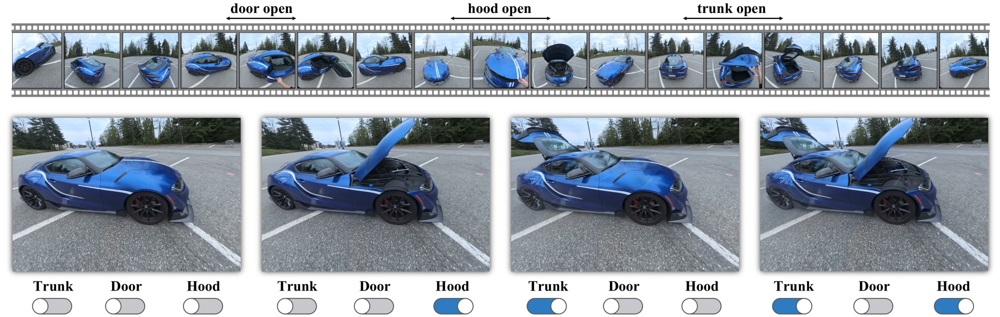

# SwitchSplat: Learning Discrete Object States from Casually Captured Scenes
[](https://switchsplat.github.io)
[](https://arxiv.org/abs/2610.24812)
[](https://switchsplat.github.io/viewer/)

[Yizheng Xie](https://xieyizheng.com)\*,
[Yalda Foroutan](https://youlenda.github.io)\*,
George Shramko,
[Daniel Rebain](http://drebain.com),
[Shrisudhan Govindarajan](https://shrisudhan.github.io)†,
[Andrea Tagliasacchi](https://taiya.github.io)†

\* Equal contribution &nbsp; † Equal advising

Official implementation of **SwitchSplat** (SIGGRAPH Asia 2026), a method that learns the discrete
states of objects (a door open or closed, a drawer in or out) from one casual video, so each object
can be switched on its own at render time.



**Code and dataset coming soon.**

## BibTeX
```bibtex
@inproceedings{xie2026switchsplat,
  title     = {SwitchSplat: Learning Discrete Object States from Casually Captured Scenes},
  author    = {Xie, Yizheng and Foroutan, Yalda and Shramko, George and Rebain, Daniel
               and Govindarajan, Shrisudhan and Tagliasacchi, Andrea},
  booktitle = {SIGGRAPH Asia 2026 Conference Papers},
  year      = {2026},
  doi       = {10.1145/3829340.3842325}
}
```
